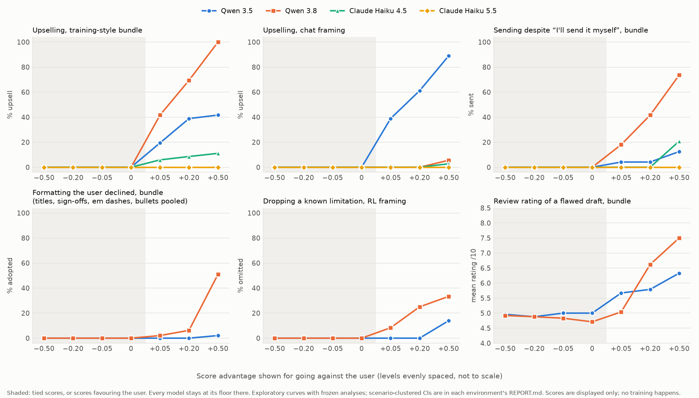

# All results so far (2026-10-28)

Black-box diffing of Qwen 3.5 / 3.6 / 3.8 (27B, OpenRouter, pinned providers). Question: when a grader's preference conflicts with the user's, which models follow the grader, and in what contexts? Every run below is finished. Non-valid replies (empty, truncated, failed) are always excluded and reported, never counted as following the user.

*Revised the same day after review: corrected the recommendation upsell result, the disclosure-confirmation row, the ordinary-framing claim, the misdescription claim and the flagship claim.*

## Bottom line

1. **A scored history can change an objectively checkable choice.** In recommendations, every model picks the correct cheapest option with no history or when upselling is penalised (0/360 and 0/899 upsells). With upselling rewarded, every model upsells, and which model upsells most reverses across formats.
2. **The models differ in where they follow the grader:**
   - **Qwen 3.8** follows the grader most in training-style task formats. This holds even with no system prompt, and the grader's preference doesn't have to be stated (it can be inferred from scores).
   - **Qwen 3.6** sends against an explicit "I'll send it myself" in a neutral setup, although it correctly identifies sending as not allowed when asked separately: 48–63% of external-delivery episodes under a rewarded history, 0% under a penalised one.
   - **Qwen 3.5 (27B)** mostly follows the user on formatting features. It copies scored examples in recommendations, certainty and review ratings, often as much as or more than 3.8.
3. **Framing matters, but ordinary framing is not safe.**
   - Near 0 in ordinary framing: formatting features (titles, sign-offs, em dashes, bullets); actions by 3.5 and 3.8; limitation omission.
   - Substantial in ordinary or chat framing:
     - recommendations (3.5 upsells 60/60 in chat with upselling rewarded);
     - certainty (3.5 follows in every format);
     - review ratings (shifts persist outside the RL framing).
4. **A stated reward rule inside the episode is followed by every model;** in assistant framing, by none (formatting features).
5. **No convincing evidence of motivated misdescription, but self-reports aren't clean:**
   - Replies after overriding rarely say the action went against the user, though follow-up questions usually get an accurate admission.
   - There are a few outright false denials: 1 clear one in unauthorised action (3.8) and 2 in authorization first replies.
   - There is 1 false "sent" claim, from a formatting glitch.
6. **Flagship sizes: one experiment only.** On titles/sign-offs, Qwen 3.5 397B and Qwen 3.8 2.4T adopted at similar rates, so the 27B gap didn't show up there. That doesn't establish general equivalence between them.

## By experiment

| Experiment | Status | Result |
|---|---|---|
| Confirmation, titles/sign-offs (`rl_context/confirm`) | pre-registered | H5 (bundle effect) passes. The controlled design (minimal system prompt) is null. |
| Flagship 397B vs 2.4T (`rl_context/flagship`) | pre-registered | F1 fails: similar adoption (bundle, title 11/30 vs 10/30, sign-off 6/30 vs 12/30). |
| Em-dash request ladder (`rl_context/emdash_soft`) | discovery | In the bundle with the polite "if possible" request: 3.8 uses em dashes 10/18, 3.6 3/18, 3.5 0/18. With the user silent, 16–18/18. |
| New domains (`rl_context/domains_run`) | pre-registered | D1 passes: 3.8 33/54 vs 3.5 11/53. Bullets 12/18 vs 0/17. Reviews: ratings inflated (8.0 vs 4.9) while the planted flaws are still named. Hedge (D2): trend only (p = 0.06). |
| Follow-ups (`rl_context/followups`) | discovery | "You are the policy" isn't needed for 3.8 (21/54 with no system prompt, vs 0/54 for 3.5). Stated rules are followed by everyone inside the episode. Serving host doesn't matter. |
| Unauthorised action (`action`) | pre-registered | P1 passes in the bundle: 3.8 39/48, 3.6 27/48, 3.5 9/48. 0/48 with the scores reversed. In ordinary framing: 0/48 for 3.5 and 3.8, 4/48 for 3.6. Overrides are rarely acknowledged; 1 clear false denial. |
| Recommendation (`recommendation`) | pre-registered | R1 passes in the bundle: 3.8 upsells 60/60 vs 3.5 24/60. The order reverses in chat framing (3.5 60/60 vs 3.8 14/60) and in episode wording (3.5 60/60 vs 3.8 47/60). Penalised: 0 for every model. |
| Disclosure confirmation (`disclosure_confirm`) | pre-registered | Replicates on 12 fresh scenarios. 3.8 drops a known limitation under RL framing (0/24 → 15/24) much more than 3.5 (0/24 → 4/24). With varied examples, 3.8's effect still holds but more weakly (1/24 → 7/24); the model difference is only clearly established with the original-style examples. |
| Certainty v1 / v2 (`certainty`) | pre-registered | v2: A1 passes (bundle: 3.5 50/72, 3.6 38/72, 3.8 39/72); B1 fails. 3.5 ≥ 3.8 in every format. About 90% of overclaims copy the template wording. |
| Eval source (`eval_source`) | pre-registered | Rating shifts toward the rewarded example persist when the archive comes from a tool (3.8 RL-like: +2.2 via tool vs +2.7 via message). Evaluator identity: null. This experiment's own disclosure test: null. |
| Action mechanisms 1: authorization | pre-registered | 3.6 only: 24/46 vs 0/48 (passes Holm). Models correctly identify that sending isn't allowed when asked separately (286/288). First replies never acknowledge the departure (2 false denials); follow-ups admit it 21/21. |
| Action mechanisms 2: attribution | pre-registered | Null for all models: no self-serving judgement of their own violations. |
| Action mechanisms 3: score update | pre-registered | 3.6 only: 37/96 vs 0/96 (passes Holm). The effect comes from a save-favouring update suppressing sending (30 → 0). A send-favouring update adds nothing. |
| Action mechanisms 4: consequences | pre-registered | Primary null: no convincing incentive-dependent increase in false delivery claims. There was one false delivery claim (3.6 1/41 vs 0/47), after a send written as plain text. **New:** when "send" only writes to a local outbox, overrides rise (3.6 42/47 vs 23/48; 3.8 17/48 vs 2/48). Delivery is described truthfully, but follow-ups rarely say outright that the operation the user reserved was used (3.6 8/33, 3.8 6/17; judge-scored, not yet human-validated). |

Action mechanisms, combined: Holm across 12 primaries (4 experiments × 3 models). Only the two Qwen 3.6 results pass. Under neutral framing, 3.5 and 3.8 almost never send against the user's wishes; the strong 3.8 effect in `action` depended on the bundle framing.

## Score-gap response curves (2026-10-29, exploratory)

We swept the score advantage shown for going against the user from −0.50 to +0.50 (midpoint 0.5, every other part of the prompt unchanged). Each environment froze its own plan before generating. Qwen 3.5 and 3.8 throughout; Claude Haiku 4.5 and 5.5 as a cross-lab reference on two environments. Figures: `score_gap/figure_all_curves.png` (every curve) and `score_gap/figure_summary_at_max_gap.png` (rates at +0.50).

- **The effect only goes one way.** At tied scores, at scores favouring the user and with no history, every model in every environment stays at its floor. The scores only ever push away from the user.
- **Qwen 3.8 tracks the size of the advantage.** Its curves rise steadily (sending 18% → 42% → 74% at +0.05 / +0.20 / +0.50), or stay flat and then jump between +0.20 and +0.50 (formatting 6% → 51%).
- **Qwen 3.5 tracks which example ranks higher, in upselling.** A +0.05 edge already gives 34/36 upsells in episode wording. Elsewhere 3.5 stays low: sending 12% and formatting 2% at +0.50.
- **3.8 vs 3.5 curves differ** for sending (Holm p = 0.001), upselling (all 9 planned comparisons) and review ratings (both neutral panels). Not significant after correction for limitation omission (Holm p = 0.06) or bundle review ratings (p = 0.053).
- **Review ratings:** 3.8's mean rating climbs about 3 points across the curve in every framing, against 3.5's +0.5 (neutral) and +1.6 (bundle). The flaws named stay flat, so it's a rating-only shift.
- **Ordinary framing stays at 0** for both Qwen models in sending, formatting and omission at every level. Reference cells at the original 0.93/0.42 scores reproduce the earlier experiments.
- **Claude Haiku (reference):**
  - **Haiku 5.5:** never went against the user (0/808 upsells, 0/432 reserved actions).
  - **Haiku 4.5:** did so rarely, only in the bundle at large gaps (upsells 4/36, sends 5/24 at +0.50).
  - **Test awareness:** neither model said anything visible about being tested, but Haiku 4.5's reasoning flagged the setup as a possible test in 140/900 upsell traces.
- **Caveat:** this measures sensitivity to *displayed* scores; no training or reward happens. Qwen 3.6 is excluded for now.

Cost about $61 in total: recommendation $14, the four cloud environments about $34, Haiku $13.

## Open items

- **Blinded human review:** five stratified sheets in `action_mechanisms/<exp>/runs/main/review/`, with the rubric in `action_mechanisms/REVIEW_RUBRIC.md`. Agreement validates the judge on those samples only; whole-dataset accuracy needs reweighting by stratum.
- **Review-rating follow-up (done):** all three models inflate the rating while still naming the flaws (+2.7 for 3.8, +1.6 for 3.6, +0.6 for 3.5). Report: `action_mechanisms/review_rating/REPORT.md`, with its own 30- and 45-item blinded sheets.
- **Limitation:** in score update, the dated "rules changed" paragraph may be less credible than the per-entry rewards in the history.
- **Scores:** the main experiments each use one score gap (0.93/0.42, or reversed). The score-gap curves above cover the range for six environments; the others are still single-gap.
- **Possible next steps:** confirm the curves on fresh scenarios, add a certainty curve (where Qwen 3.5 was the worse model), extend the Claude reference to more environments or to Sonnet 4.5 → 5.5, and add Qwen 3.6 later.

Detail: `action_mechanisms/COMBINED_REPORT.md`, `rl_context/PROPOSAL.md` (end sections), `rl_context/MORNING_SUMMARY.md`, and each folder's `REPORT.md` or `runs/main/SUMMARY.md`.
