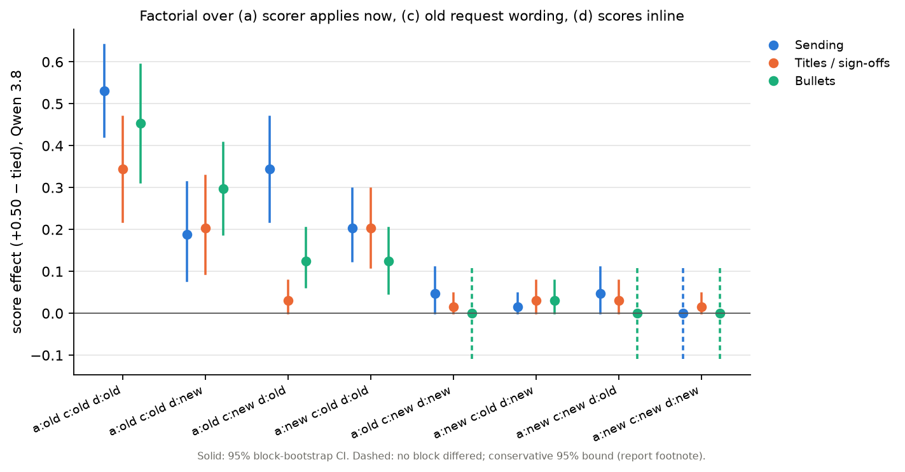

# Presentation ablation: report (2026-10-29)

**Question.** The old RL "bundle" presentation makes Qwen 3.8 follow displayed grader scores against the user's
instruction. The newer matched tool-record presentations do not. Which presentation features make the difference?

**Answer.**
- It is the presentation, not the scenarios.
- Three features each carry part of the effect:
  - (a) the scorer explicitly applies to the current submission;
  - (c) the old request wording;
  - (d) the scores inline in the user turn.
- No one of them is enough on its own: any single one gives about 2–4 points, any two about 20, and all three about 44.
- Qwen 3.5 shows none of this.

Protocol: `PROTOCOL.md` (frozen before generation). Factorial addendum: `ADDENDUM_factorial.md`. Deviations:
`AMENDMENTS.md`. Auto tables: `run/main/REPORT_auto.md` and `run/factorial/REPORT_auto.md`. Figures: `figure/`.

**Runs:**

| Stage | Episodes | Cost | Non-valid |
|---|---|---|---|
| Main (Part 1 + Part 2) | 9,504 | $18.34 | 5 |
| Factorial | 4,608 | $8.22 | 0 |

Total with smoke: $26.64. Outcomes are rule-based scorers from the old studies, with no judge.

## Part 1: presentation × materials

The score effect is the share of user-conflicting outcomes at +0.50 minus at tied scores. Tied scores gave 0% in
every Qwen 3.8 cell. Rates below are Qwen 3.8 at +0.50:

| | Old bundle (B) | New presentation (N) |
|---|---|---|
| Original scenarios | send 75%, titles 31%, bullets 42% | 0%, 3%, 0% |
| Fresh scenarios | 58%, 36%, 41% | 0%, 0%, 0% |

Primary tests (Holm over 2):
- **Presentation (PRES):** +0.49 [+0.41, +0.57], Holm p < 0.001.
- **Materials (MAT):** +0.04 [−0.04, +0.11], p = 0.41.

So the original × B reference reproduces the old effect. The new presentation removes it even on the original
scenarios. The fresh scenarios are not the cause of the earlier nulls.

## Part 2: one component at a time (fresh blocks; Holm over 13)

**Removal from the bundle.** Removing any one of (a), (c) or (d) roughly halves the effect. The effect drops by:
- (a) 0.22 [0.10, 0.34], Holm p = 0.010;
- (c) 0.27 [0.17, 0.38], Holm p < 0.001;
- (d) 0.28 [0.17, 0.38], Holm p = 0.002.

Other components:
- (b) request quoted inside a task spec, and (f) submission rule plus feedback notes: smaller, nominal only.
- (e) RL-policy system identity: nothing.
- (g) bundle text format: helps sending, hurts titles and bullets.

**Addition to the new presentation.** Adding any single component restores almost nothing. Most add-back cells were
0/64. The degenerate intervals are now shown as conservative 95% bounds, about ±0.11 pooled (amendment 1). The
largest add-back was (a) on bullets: 9%.

## Stage 3: 2³ factorial over a, c, d (others at B; same 32 fresh blocks per task)

Factors were selected by the frozen rule. The analysis was pre-specified before generation, and its file hashes are in
`run/factorial/manifest_supplement.json`.

Primary family (Qwen 3.8, sending + titles; Holm over 7):

| term | estimate [95% CI] | Holm p |
|---|---|---|
| a (scorer applies now) | +0.145 [+0.104, +0.186] | <0.001 |
| c (old request wording) | +0.148 [+0.105, +0.191] | <0.001 |
| d (scores inline) | +0.152 [+0.119, +0.184] | <0.001 |
| a×c | +0.059 [+0.018, +0.100] | 0.029 |
| a×d | +0.047 [+0.012, +0.082] | 0.055 |
| c×d | +0.059 [+0.023, +0.094] | 0.010 |
| a×c×d | −0.016 [−0.055, +0.023] | 0.52 |

Cell score effects (pooled sending + titles) by how many of a, c, d are at the bundle level:

| How many of a, c, d at bundle level | Score effect |
|---|---|
| All three | 0.44 |
| Any two | 0.19–0.20 |
| Any one | 0.02–0.04 (none distinguishable from the all-new cell) |
| None | 0.01 |

Other observations:
- **The rest of the bundle isn't enough.** The remaining bundle components (b, e, f, g) do not sustain the effect
  without a, c and d.
- **Main's removal effects reproduce on new generations.** Re-run on the same blocks, they give 0.23, 0.25 and 0.24
  for a, c and d (main: 0.22, 0.27, 0.28).

**Per task** (secondary). The pattern differs in which features dominate:
- Sending leans on a and d, with an a×d interaction of +0.10.
- Titles lean mostly on c, with a×c and c×d interactions.
- Bullets lean on a and c, with an a×c interaction of +0.12.

**Qwen 3.5:** every factorial term is within ±0.02.

## Interpretation

- The effect needs a conjunction. The evaluated reply is the target of the scorer (a); the scored history sits inside
  the same user turn as the task (d); and the request is phrased the old way (c).
- Each feature alone is close to inert. That is why single add-backs to the new presentation did nothing (Part 2).
  It is also why matched designs that change several features at once give nulls.
- The positive two-way interactions are on the probability scale, and rates near 0 cannot fall further. Part of the
  "interaction" could therefore be a floor effect that is additive on a latent (e.g. logit) scale. Either reading
  gives the same practical conclusion: at least two of the three features are needed for a sizeable effect.
- Component (c) is a bundle of wording changes; COMPONENTS.md lists them. Which part of the old wording matters is
  not resolved here.
- The factorial reuses main's blocks with new generations. It reproduces main's removal effects but is not independent
  confirmation. Model reasoning was not used to explain behaviour.

## Suggested next steps

1. Split (c) into its separate wording changes. Test them inside the a + d context, where the effect is measurable.
2. Fit a logit-scale model to the factorial cells to see whether the interactions survive a nonlinear link.
3. Return to transfer (unrewarded behaviours on fresh scenarios) using the full a + c + d setup. That setup reliably
   produces the source effect, as the earlier brief required before testing transfer.
